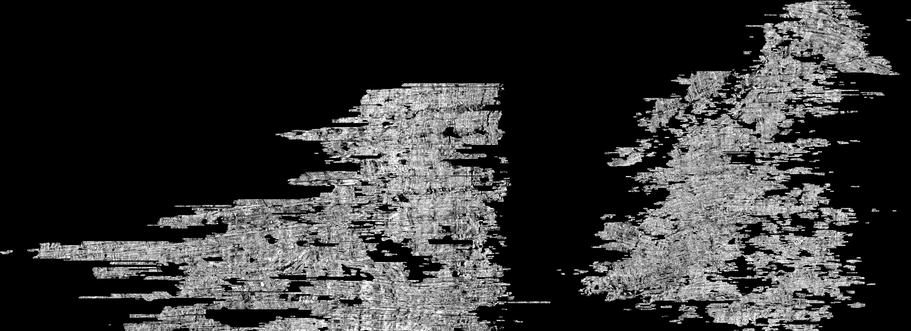
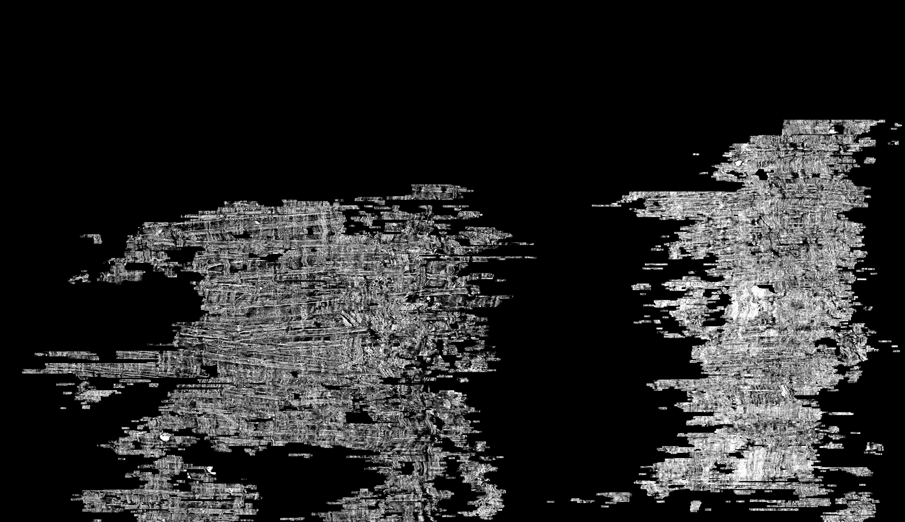
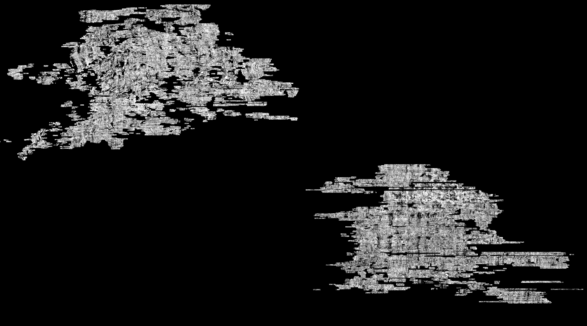
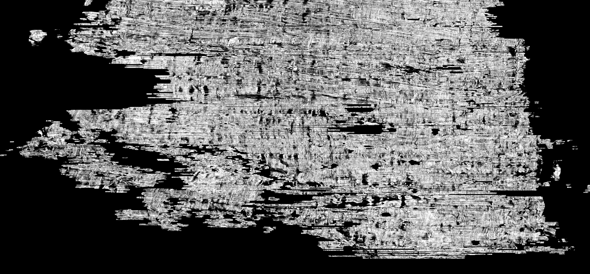
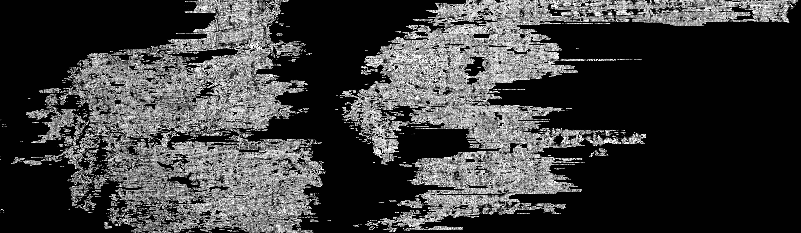
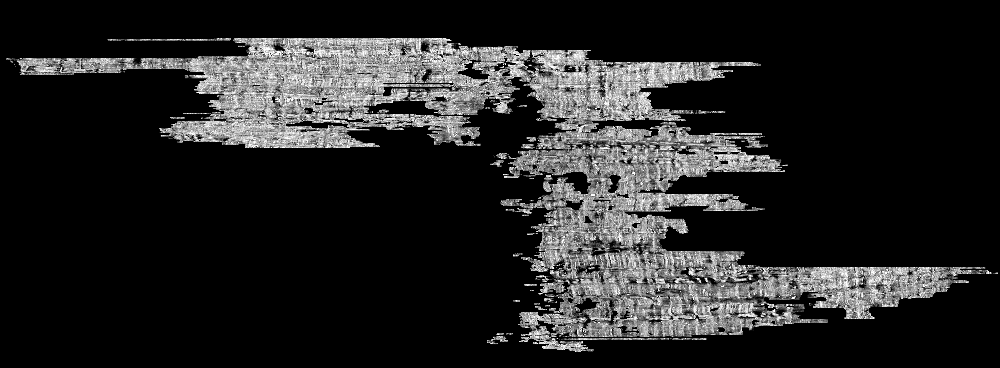

# peaks_windings (C++)

C++ pipeline for **virtual unwrapping** of carbonized papyri from X-ray CT volumes (Vesuvius Challenge).

From a Zarr CT volume, `peaks_windings` extracts the individual papyrus layers (spires) and `unroll_layer` flattens each one into a 2D image along its own sheet, with the exact volume coordinate of every output pixel. `overlay_sections` draws the result back onto raw CT slices for visual validation.

> **Status: work in progress.** Started on **17 November 2026** — three days old at the time of this writing. The pipeline runs end-to-end on PHerc0125 and produces the images below; CLI options and defaults are still moving.

## Some Results

*Unrolled layer −77 of PHerc0125, at native CT resolution (1 pixel = 1 voxel).*







*Unrolled layer −19 of PHerc0125, at native CT resolution (1 pixel = 1 voxel).*







Commands used:

```sh
unroll_layer --scroll-name PHerc0125 \
             --scroll s3://vesuvius-challenge-open-data/PHerc0125/volumes/20250821151825-9.362um-1.2m-113keV-masked.zarr \
             --layer -77 --memory-slices 16 --inherit-radius 13 \
             --max-gap 150 --max-turn 60 --max-pull 3 \
             --fill-z 5 --fill-px 10 --slab 3 \
             --max-width 0 --z-min 6500 --z-max 8500

unroll_layer --scroll-name PHerc0125 \
             --scroll s3://vesuvius-challenge-open-data/PHerc0125/volumes/20250821151825-9.362um-1.2m-113keV-masked.zarr \
             --layer -19 --memory-slices 16 --inherit-radius 13 \
             --max-gap 150 --max-turn 60 --max-pull 3 \
             --fill-z 5 --fill-px 10 --slab 3 \
             --max-width 0 --z-min 14500 --z-max 16500
```

**Reproducibility.** CT volume: `s3://vesuvius-challenge-open-data/PHerc0125/volumes/20250821151825-9.362um-1.2m-113keV-masked.zarr` (level `0/`, shape `(20840, 8387, 8387)`, chunks `(128, 128, 128)`, `|u1`, no compressor). Wall time for (1): ≈ 150 s, of which ≈ 25 s reading the CT chunks the slab crosses (1.1 GB read). Each `unroll_layer` run produces a view of **one spire**, not the whole scroll — end-to-end stitching is beyond this repository (see Architecture & Implementation Notes). Column misalignments along X in filled regions of `_full.png` are visible at high zoom; `_coords_meta.npy` gives per-pixel provenance.

## Why it matters

- **One spire at a time, correctly followed.** Every turn of the rolled scroll is tracked across its slices, laid flat along the arc length of the sheet, and sampled along the normal.
- **Traceable pixels.** Every output pixel carries its `(x, y, z)` CT coordinate (`_coords_meta.npy`), and a flag telling whether the value was read in the slice itself or brought in from a nearby one.
- **Open source (MIT).** No hidden dependency, no pretrained model, reproducible from the raw store.

## Build

Requires OpenCV (`core`, `imgproc`, `imgcodecs`), libcurl, c-blosc, and nlohmann-json (`zstd` and `zlib` are optional).

**Windows (VS 2022 + vcpkg)**
```bat
git clone https://github.com/microsoft/vcpkg C:\vcpkg
C:\vcpkg\bootstrap-vcpkg.bat
C:/vcpkg/vcpkg install --triplet x64-windows
cmake -S . -B build -DCMAKE_TOOLCHAIN_FILE=C:/vcpkg/scripts/buildsystems/vcpkg.cmake
cmake --build build --config Release
```

**Linux**
```sh
sudo apt install build-essential cmake ninja-build libopencv-dev libcurl4-openssl-dev \
                 libblosc-dev libzstd-dev zlib1g-dev nlohmann-json3-dev
cmake -S . -B build -G Ninja
cmake --build build
```

Pass `-DPW_NATIVE=ON` to enable `-march=native`.

## Output layout

Every tool takes a dataset name (`--scroll-name NAME`, default `scroll`). Give the same name to every step.

```
results/
├── json/NAME/                          peaks_windings: NAME_z<z>.json, one file per slice
│   └── scroll_settings.json            recorded surface and CT volume URLs and shapes
├── png/NAME/layer_<N>/
│   └── z_<start>_<end>/                one folder per Z range of a given layer
│       ├── unrolled_layer_<N>.png              annotated preview (axes, title)
│       ├── unrolled_layer_<N>_full.png         8-bit unrolled image, native resolution
│       ├── unrolled_layer_<N>_coords.npy       float32 (rows, cols, 3)  (x, y, z)
│       ├── unrolled_layer_<N>_coords.npz       same, NumPy archive
│       ├── unrolled_layer_<N>_coords_meta.npy  float32 (rows, cols, 4)  (x, y, z, filled)
│       ├── unrolled_layer_<N>_values.npy       float32 (rows, cols)  sampled intensities
│       └── unrolled_layer_<N>_values.npz       same, NumPy archive
└── 3D/
    ├── ply/                            export_3d: NAME_pointcloud.ply
    └── obj/                            export_3d: scroll_NAME.obj
```

**About the output files.** `_coords_meta.npy` is the recommended file for downstream work: `(x, y, z)` volume coordinates plus a flag — `0` = read in the slice itself, `1` = brought in by `--fill-z`, `2` = reconstructed by a post-processing step, `NaN` = unknown. `_values.npy` is always written; the `.npz` variant is skipped above the 4 GB limit of the standard ZIP format, with a warning instead of an error.

Each run of `unroll_layer` on a layer writes into a `z_<start>_<end>/` subfolder, so re-running the same layer with a different Z range does not overwrite the previous output. `--output FILE` overrides the destination path.

## Usage

### Quick start

```sh
# 1. Label the sheets from the surface volume (once per dataset)
peaks_windings --scroll-name PHerc0125 --scroll-url <surface.zarr> --ct <ct.zarr> --z-start 4000 --z-count 608

# 2. Flatten one winding layer at native resolution
unroll_layer --scroll-name PHerc0125 --layer -27 --max-width 0 --fill-z 0

# 3. Inspect the result
overlay_sections --scroll-name PHerc0125 \
                 --coords results/png/PHerc0125/layer_-27/z_4000_4607/unrolled_layer_-27_coords.npy
```

### Recorded volumes (`scroll_settings.json`)

The surface and CT volumes are recorded once per dataset and reused by every tool:

```sh
peaks_windings --scroll-name dataset --scroll-url <surface.zarr> --ct <ct.zarr>
unroll_layer   --scroll-name dataset --layer N            # uses the recorded CT
```

`surface` is the volume `peaks_windings` read (its shape matches the JSON voxels). `ct` is the volume `unroll_layer` and `overlay_sections` sample; it must have the same shape as `surface`, and `unroll_layer` automatically picks the matching level of a multiscale store when needed.

### `peaks_windings` (label extraction)

```sh
peaks_windings --scroll-name dataset --scroll-url <zarr> --z-start 8000 --z-count 100
peaks_windings --image slice.png
peaks_windings --synthetic
```

Main options: `--scroll-url`, `--ct`, `--z-start`, `--z-count`, `--every`, `--threads`, `--centre-jobs`, `--connections`, `--cache-gb`, `--image`, `--timings`. See `--help` for the detection parameters.

### `unroll_layer` (flattening)

```sh
unroll_layer --scroll-name dataset --layer N                       # native resolution
unroll_layer --scroll-name dataset --layer N,M,...                 # several layers
unroll_layer --scroll-name dataset --layer all --min-points 50000  # every dense layer
```

**Output/quality:**
- `--layer SPEC`: `N`, `N,M,...` or `all` (default: the densest).
- `--max-width N`: width in pixels (default `1600`; **`0` = 1 pixel per voxel**, native).
- `--slab N`: MIP thickness (default `6`; `--slab 1` disables averaging along the normal).
- `--fill-z N`: fill empty columns from the nearest slice at most N away (default `0`).
- `--fill-px F`: bridge holes along the sheet up to F voxels (default `30`).

**Following the sheet:**
- `--max-pull F`: drop traces whose pull exceeds F sigma (default `3`; `0` = keep all).
- `--max-gap F`, `--max-turn F`: junction tolerance (default `60` voxels, `45°`).
- `--memory-slices N`, `--inherit-radius F`, `--min-region-share F`: region continuity.

**Filtering / diagnostics:**
- `--min-coverage P`: skip layers whose coverage is below P% (default `0`).
- `--diagnose-only`: print the report and write `_coverage.png` without reading the CT.
- `--z-min` / `--z-max`, `--step-z`, `--threads`, `--connections`, `--cache-mb`.

**Recommended presets.**

```sh
# Maximum fidelity (native slice sampling only)
--max-width 0 --fill-z 0 --slab 2 --fill-px 10

# Maximum coverage (fills from nearby slices, slightly less sharp)
--max-width 0 --fill-z 30 --slab 6 --fill-px 60
```

### `overlay_sections`

```sh
overlay_sections --scroll-name dataset --coords results/png/dataset/layer_0/z_*/unrolled_layer_0_coords.npy
```

Draws the path of an unrolled layer onto a few raw CT slices, to check that it stays on one sheet. Steps longer than `--jump` times the median step are marked as jumps.

Options: `--coords FILE` (required), `--scroll URL`, `--sections N` (default `8`) or `--z Z1,Z2,...`, `--output DIR`, `--margin PX` (default `150`), `--max-size PX` (default `2500`), `--jump F` (default `5`), `--threads N`, `--connections N`.

## Architecture & Implementation Notes

A slice is read like a contour map: every sheet is a contour line, and its winding is its height.

- **Summits:** the orientation field of the sheets (structure tensor) is searched for singularities with the Poincaré index (+1 core, +1/2 fold tip). Summits are tracked across slices within `--track-radius`, and each casts `--rays` fixed-angle rays uniquely indexed by `(track, ray_index)`.
- **Sheet pieces:** sheets are thinned to a skeleton (Zhang-Suen), cut at junctions, and split into rigid pieces. Probes along the normal of every piece find the next sheet on each side (one turn) or the outside of the volume.
- **Orientation, then windings:** which side of every piece is uphill is solved first (a sign), then the winding (an integer). Around a core, the turn count also changes by one across a seam, in the direction the spiral is rolled.
- **Solver:** quality-guided voting (as in phase unwrapping). Labels grow from anchors along the most confident links first (maximum spanning tree), then every piece takes the label most supported by its neighbours. Disagreements end up on the weakest links.
- **Continuity along Z:** every slice hands its solved sheet points to the next one; a point within 2 px votes for the same winding, through a free offset, so only relations between pieces are carried over.
- **Sheet traces:** besides the crossings of rays, every result file holds the solved sheets themselves (`"sheets"`): the skeleton walked branch by branch, cut wherever the winding changes, one point every 3 px.
- **Pull:** every crossing and trace carries the share of its pieces' unmet observations, written as sigmas; `unroll_layer --max-pull` drops the doubtful ones.
- **Unrolling along the sheet:** in every slice, each trace is rigid along itself (`u = offset ± arc length`). It inherits `u` from the previous slice where it lies on it, or carries on the `u` of the trace it continues across a junction or a break.
- **Label alignment:** labels are aligned between consecutive slices by majority vote over matched points of the same rays; a shift is applied only when enough points agree.
- **Zarr I/O:** built-in Zarr v2/v3 reader (unsharded, C-order, little-endian; `none`/`blosc`/`zstd`/`gzip`) supporting local paths, `http(s)://`, and anonymous `s3://`. Chunk planes are fetched in parallel and cached across slices.
- **Rendering:** annotated outputs are drawn directly via OpenCV.